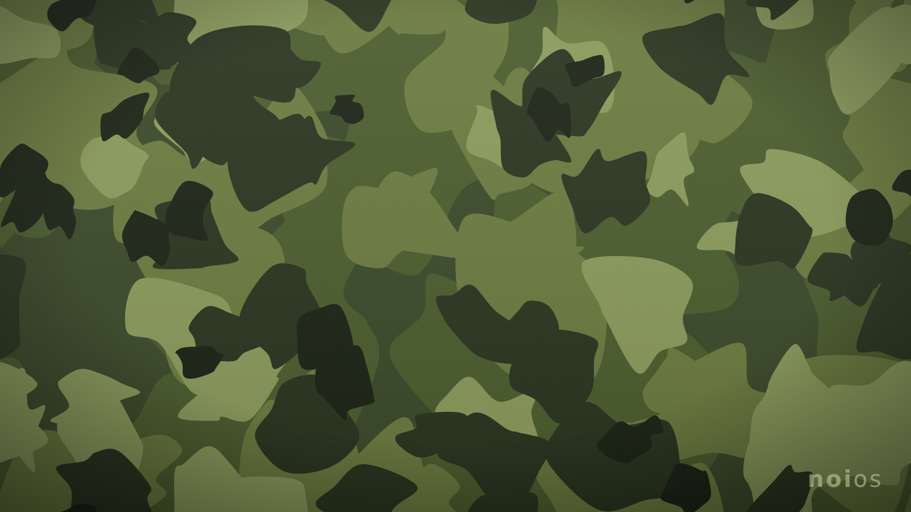

# Noi OS 🌿

**Noi OS** ist ein eigenes Ubuntu-Derivat mit **KDE Plasma** und durchgehendem
**Camouflage-Grün-Design**. Basis ist **Ubuntu 24.04 LTS (Noble)**, mit
Sicherheitsupdates bis 2029.




## Was macht Noi OS aus?

| Bereich | Noi OS |
|---|---|
| Basis | Ubuntu 24.04 LTS, alle Ubuntu-Paketquellen |
| Desktop | KDE Plasma 5.27 (X11 + Wayland) |
| Design | eigenes Camo-Hintergrundbild, Farbschema „Noi Camo“, Breeze Dark, grünes Logo, eigene Boot-Animation |
| Installer | Calamares mit eigenem Branding und eigener Diashow |
| Pakete | **kein Snap** (gesperrt), stattdessen `.deb` + **Flatpak** in Discover |
| Firefox | als `.deb` direkt aus Mozillas APT-Repository |
| Vorinstalliert | Firefox, LibreOffice, VLC, Dolphin, Kate, Okular, Gwenview, Spectacle u. a. |
| Sprache | Deutsch, Tastatur `de`, Zeitzone Europe/Berlin (in `config.sh` änderbar) |

## Projektstruktur

```
noi-os/
├── config.sh                 ← Name, Version, Sprache, Optionen (hier anpassen!)
├── config/packages.list      ← welche Programme installiert werden
├── build.sh                  ← baut die ISO
├── make-vm.sh                ← baut fertige VM-Images (OVA, QCOW2, VHDX)
├── test-vm.sh                ← startet die ISO in QEMU
├── chroot/setup.sh           ← richtet das System im chroot ein
├── iso/grub.cfg              ← Bootmenü der Live-ISO
├── tools/make-camo-wallpaper.py  ← erzeugt das Camouflage-Hintergrundbild
└── branding/                 ← Paket "noios-branding"
    ├── artwork/logo.svg
    ├── NoiCamo.colors        ← KDE-Farbschema in Camo-Grün
    ├── files/                ← Dateien, die ins System kommen
    ├── DEBIAN/               ← Paket-Metadaten (inkl. dpkg-divert für os-release)
    └── build-deb.sh
```

## ISO herunterladen (automatisch von GitHub gebaut)

Du brauchst keinen Linux-PC: GitHub baut die ISO selbst.

1. Im Repo oben auf **Actions** klicken
2. Links **„Noi OS bauen“** wählen, dann rechts **„Run workflow“** → **„Run workflow“**
3. Ca. 1 Stunde warten
4. Unter **Releases** (rechte Seite der Repo-Startseite) die `.part`-Dateien herunterladen
   und wie in den Release-Notizen beschrieben zusammenfügen

Alternativ startet jeder Tag-Push (z. B. `git tag v1.0 && git push --tags`) einen Build.

**Automatische Updates:** Am **1. jedes Monats** baut GitHub Noi OS von selbst neu,
mit allen aktuellen Ubuntu-Sicherheitsupdates. Es bleiben immer die **3 neuesten**
automatischen Builds erhalten. Von Hand getaggte Versionen wie `v1.0` werden nie
gelöscht. Den Zeitpunkt änderst du in `.github/workflows/build-iso.yml` unter `cron`.

> Bereits installierte Systeme brauchen keine neue ISO: Sie bekommen Ubuntus
> Updates ganz normal über die Aktualisierungsverwaltung bzw. Discover.

## Fertige VM (VirtualBox, VMware, Proxmox, Hyper-V …)

Wer Noi OS nicht erst installieren will, nimmt ein **fertiges VM-Image** aus den
[Releases](../../releases):

| Datei | VM-Software |
|---|---|
| `.ova` | VirtualBox, VMware Workstation/Player/Fusion/ESXi |
| `.qcow2` | Proxmox, virt-manager/KVM, GNOME Boxes, UTM |
| `.vhdx.zip` | Hyper-V |

Beim **ersten Start** öffnet sich ein Assistent. Dort wählst du Sprache und Tastatur
und **erstellst dein eigenes Benutzerkonto**. Danach startet Noi OS ganz normal.

Selbst bauen (nach `./build.sh`):

```bash
sudo ./make-vm.sh                       # alle Formate
sudo VM_FORMATS=qcow2 ./make-vm.sh      # nur eines
```

## ISO selbst bauen

Voraussetzung: ein Ubuntu- oder Debian-System (auch eine VM), etwa **25 GB freier
Speicher**, Internet und `sudo`. Fehlende Build-Werkzeuge installiert das Skript
selbst.

```bash
sudo ./build.sh
```

Ergebnis: `out/noios-1.0-amd64.iso` (ca. 3 GB) plus `.sha256`.

Der Build läuft in 5 Stufen: `bootstrap → branding → chroot → squashfs → iso`.
Nach einem Abbruch setzt `sudo ./build.sh` an der richtigen Stelle fort.

```bash
sudo ./build.sh iso        # nur ISO neu packen (z. B. nach Änderung am Bootmenü)
sudo ./build.sh squashfs   # ab squashfs neu
sudo ./build.sh rebuild    # komplett von vorn
sudo ./build.sh clean      # Build-Verzeichnis löschen
```

## Testen

```bash
sudo apt install qemu-system-x86 ovmf
./test-vm.sh               # BIOS
./test-vm.sh uefi          # UEFI
./test-vm.sh uefi install  # mit virtueller Festplatte, um den Installer zu testen
```

Auf einen USB-Stick schreiben (**Achtung: `/dev/sdX` richtig wählen!**):

```bash
sudo dd if=out/noios-1.0-amd64.iso of=/dev/sdX bs=4M status=progress oflag=sync
```

Oder ganz bequem mit [Ventoy](https://www.ventoy.net) bzw. balenaEtcher.
Die ISO startet per BIOS und UEFI, **auch mit aktivem Secure Boot**.

## Anpassen

- **Name/Version:** `config.sh`
- **Programme:** `config/packages.list`
- **Hintergrundbild:** in `tools/make-camo-wallpaper.py` Farben (`BASE`, `LAYERS`)
  ändern oder mit `--seed` ein anderes Muster erzeugen:
  ```bash
  python3 tools/make-camo-wallpaper.py vorschau.svg --seed 7
  ```
- **Farbschema:** `branding/NoiCamo.colors`
- **Installer-Diashow:** `branding/files/etc/calamares/branding/noios/show.qml`

Nach Änderungen am Branding: `sudo ./build.sh branding`. Damit wird das System
neu aufgesetzt, denn das Branding wird im chroot installiert.

## Bekannte Einschränkungen / nächste Schritte

- **Eigenes Update-Repository:** Für Updates des Branding-Pakets lohnt sich später
  ein eigenes APT-Repo (z. B. mit `reprepro` oder `aptly`, gehostet auf GitHub Pages).
- `HOME_URL` & Co. in `config.sh` zeigen noch auf `example.org`.

## Rechtliches

Noi OS ist ein inoffizielles Derivat und steht in keiner Verbindung zu Canonical.
„Ubuntu“ ist eine Marke von Canonical Ltd. Das Noi-Branding ersetzt das
Ubuntu/Kubuntu-Branding, so wie es die
[Ubuntu-Markenrichtlinien](https://ubuntu.com/legal/trademarks) für Derivate
verlangen.
